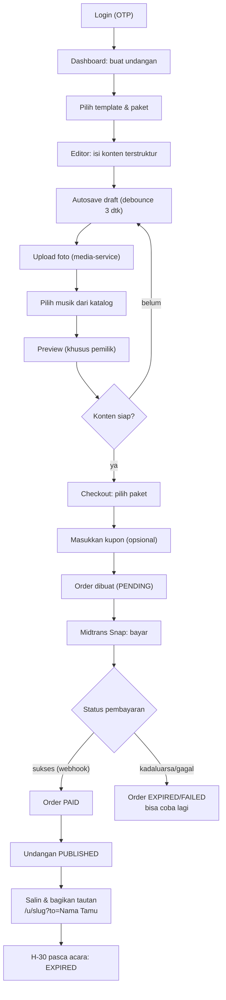
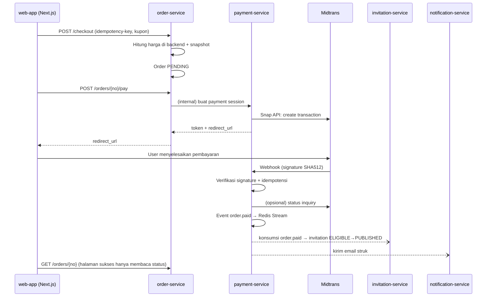
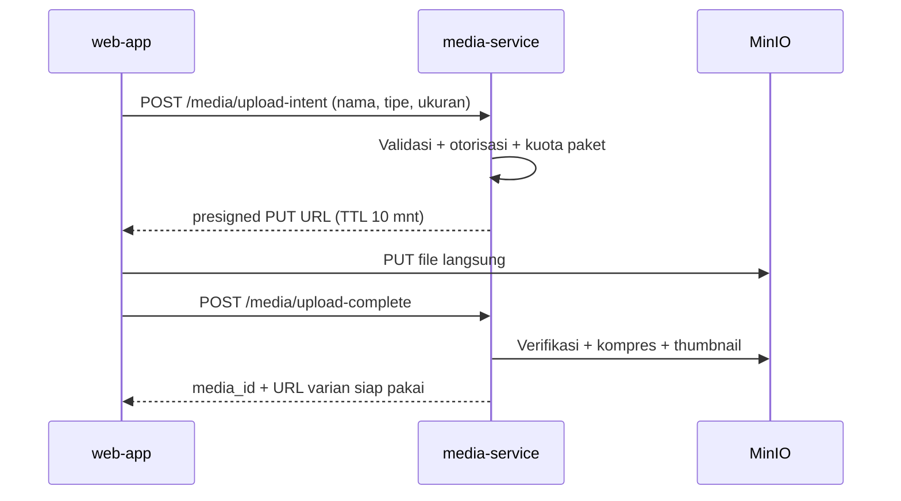
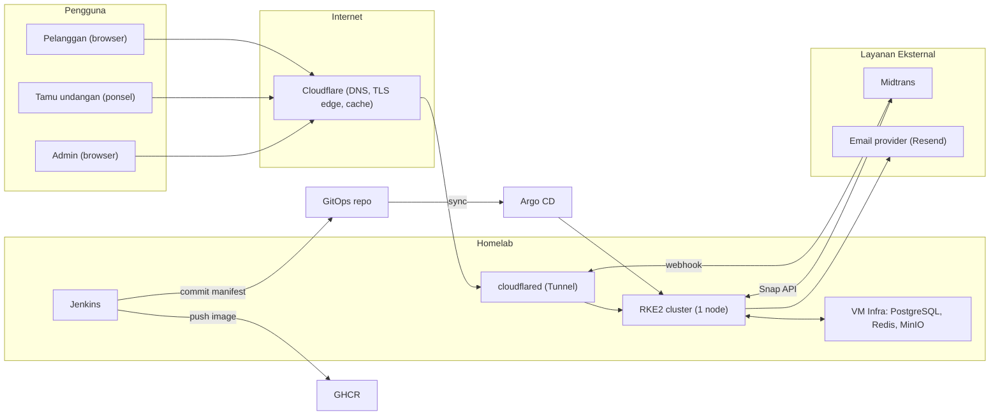
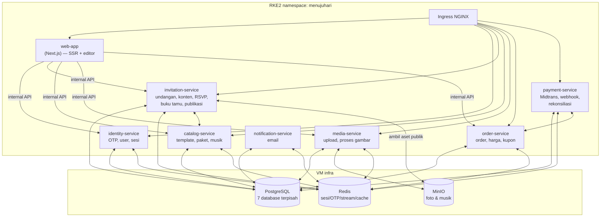
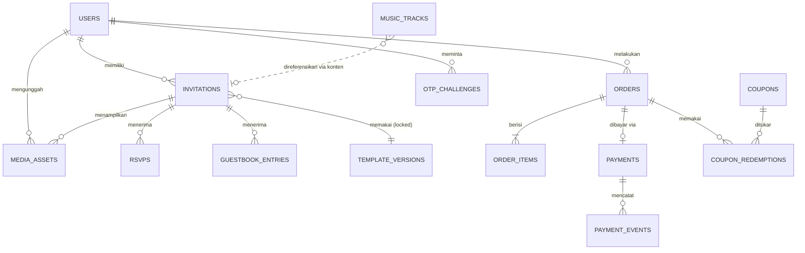
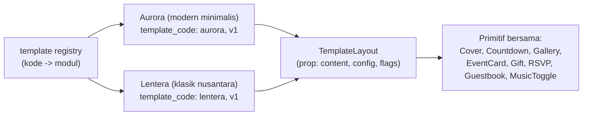
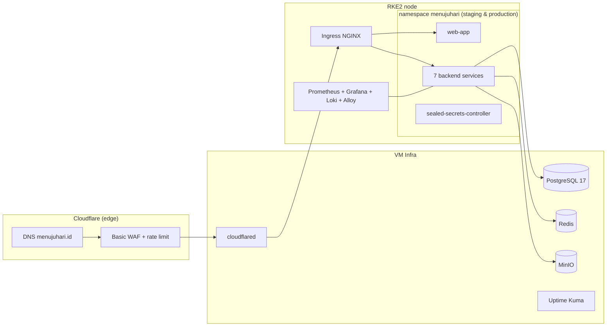

# PROJECT PLAN — Menuju Hari: Platform Undangan Pernikahan Digital

| | |
|---|---|
| **Versi dokumen** | 1.0 |
| **Tanggal** | 12 Oktober 2026 |
| **Status** | Disetujui untuk menjadi acuan perencanaan & spesifikasi teknis |
| **Penyusun** | Kolaborasi product owner (Rizky) + arsitek (AI) |
| **Sifat** | Dokumen planning utama; bukan spesifikasi implementasi detail |

> Konvensi istilah: istilah teknis (mis. *webhook*, *slug*, *draft*) dipertahankan dalam bahasa Inggris sesuai lazimnya. Status keputusan ditandai: **[DIKUNCI]** = sudah disepakati product owner; **[ASUMSI]** = keputusan sementara yang dapat diubah dengan konsekuensi yang dijelaskan; **[TERBUKA]** = perlu keputusan sebelum implementasi terkait.

---

## 1. Ringkasan Eksekutif

**Visi produk.** Menuju Hari adalah platform SaaS berbahasa Indonesia tempat pasangan membuat undangan pernikahan digital yang menarik tanpa keahlian desain: pilih template, isi konten melalui editor dengan preview real-time, bayar sekali, dan bagikan satu tautan ke tamu melalui WhatsApp.

**Target pengguna.** Pasangan (calon) mempelai di Indonesia, umur 22–35, mayoritas mengelola undangan dari ponsel dan menyebar undangan melalui WhatsApp/Instagram. Segmen sekunder: reseller dan wedding organizer (pasca-MVP).

**Proposisi nilai utama.**
1. Halaman undangan publik yang **sangat cepat** dibuka dari HP dan tampil rapi sebagai pratinjau di WhatsApp (OG preview) — titik lemah umum kompetitor.
2. **Editor WYSIWYG dengan preview real-time**, mobile-first — kompetitor umumnya masih memakai form kaku.
3. Harga transparan, sekali bayar, semua fitur inti tidak dipecah-pecah dengan biaya tersembunyi.

**Model komersial [DIKUNCI].** Sekali bayar per undangan (*one-time purchase*), dengan masa aktif seragam: **aktif sampai tanggal acara + 30 hari**. Tiga paket berbayar (Silver Rp49.000, Gold Rp99.000, Platinum Rp179.000 — harga *placeholder* final ditentukan product owner) dan satu paket Gratis ber-*watermark* sebagai funnel akuisisi. Kupon diskon mendukung promosi.

**MVP yang direkomendasikan.** Autentikasi OTP email, dashboard, katalog template (2 template identitas visual berbeda), editor konten terstruktur dengan draft/autosave, manajemen media (foto + musik dari katalog), preview, checkout Midtrans, kupon, riwayat order, halaman undangan publik dengan sapaan nama tamu, RSVP dasar + buku tamu, amplop digital pasif, dan administrasi minimal. Pembeda yang di-commit sejak MVP: performa halaman publik dan kualitas editor (Bab 2 & 4).

**Keputusan arsitektur utama.**
- Backend **Java 25 LTS + Spring Boot 4.1.x**, **microservices penuh [DIKUNCI]** dengan 7 service berbatas domain tegas (`identity`, `invitation`, `catalog`, `media`, `order`, `payment`, `notification`) + frontend terpisah (Next.js) yang menjadi satu-satunya pemilik logika render template.
- PostgreSQL (satu instance, **database terpisah per service**), Redis (sesi, OTP, rate limit, cache, event stream), MinIO (S3-compatible) untuk media.
- Deploy di RKE2 (1 node) yang sudah ada, masuk via Cloudflare Tunnel + Ingress NGINX; CI Jenkins → image ke GHCR → GitOps repo → Argo CD.
- Frontend **Next.js 16 (App Router) + React 19 + TypeScript + Tailwind CSS v4**: SSR untuk halaman publik dan landing page, interaktif penuh untuk editor.

**Risiko utama.** (1) Homelab 1 node sebagai host produksi pembayaran nyata — dimitigasi dengan backup eksternal teruji, monitoring, dan runbook migrasi darurat; (2) beban operasi 7 service bagi solo developer — dimitigasi dengan pola seragam, monorepo, dan tooling otomatis; (3) kepatuhan hukum (UU PDP, perpajakan) — perlu konsultasi profesional sebelum menerima pembayaran nyata. Rincian di Bab 18.

---

## 2. Ruang Lingkup Produk

### 2.1 Persyaratan terkonfirmasi [DIKUNCI]

| # | Keputusan |
|---|---|
| K1 | Payment gateway: **Midtrans (Snap)**. Redirect/hasil di browser **tidak** boleh menandai order lunas; hanya webhook terverifikasi & inquiry. |
| K2 | Siklus hidup undangan berbayar: **aktif sampai tanggal acara + 30 hari**, lalu kedaluwarsa. |
| K3 | Tanggal acara berubah setelah bayar → masa aktif dihitung ulang ke tanggal acara baru + 30 hari (tanpa refund prorated). |
| K4 | Multi-acara (akad & resepsi) → masa aktif dihitung dari **tanggal acara terakhir** + 30 hari. |
| K5 | Kedaluwarsa → halaman publik menampilkan "undangan telah berakhir"; konten **diarsipkan 6 bulan**, lalu dihapus (foto & konten; data transaksi disimpan sesuai kewajiban). |
| K6 | Model penjualan: sekali bayar per undangan, tier fitur (Gratis/Silver/Gold/Platinum), masa aktif seragam (K2). |
| K7 | RSVP dasar (nama, hadir/tidak, jumlah) **dan** buku tamu (ucapan & doa) masuk MVP, dikunci ke paket Gold ke atas. |
| K8 | Paket Gratis ber-*watermark* sebagai funnel akuisisi: 2 template dasar, galeri 3 foto, tanpa musik, aktif s/d akhir hari tanggal acara. |
| K9 | Arsitektur backend: **microservices penuh**, Java + Spring Boot, deploy di RKE2 yang sudah ada (1 node saat ini). |
| K10 | Bahasa antarmuka pelanggan: **Indonesia** (arsitektur konten tetap terstruktur agar i18n tidak mahal di masa depan). |
| K11 | OTP email *passwordless*; tanpa password tradisional. |
| K12 | 2 template awal dengan identitas visual berbeda; template = komponen terversifikasi, bukan halaman hardcoded. |
| K13 | Musik hanya dari **katalog platform** (tidak ada unggahan musik bebas di MVP) — pertimbangan lisensi. |
| K14 | Infrastruktur: homelab Proxmox + RKE2 (2 VM worker + 1 VM infra), Cloudflare Tunnel, Jenkins, Argo CD; mulai dari 1 node. |

### 2.2 Asumsi eksplisit [ASUMSI]

| # | Asumsi | Konsekuensi bila salah |
|---|---|---|
| A1 | Draft tidak kedaluwarsa, tetapi dibatasi **maks. 3 draft aktif per akun** (semua tier) untuk menahan biaya penyimpanan dan mencegah abuse. | Kuota draft berubah → hanya batasan validasi, dampak desain minimal. |
| A2 | Kapasitas solo dev ±15–20 jam/minggu. | Estimasi fase (Bab 14) meluncur/dipercepat. |
| A3 | Pelanggan 1 akun dapat memiliki undangan berbayar **tidak terbatas** (satu order = satu undangan). | Perlu relasi order↔undangan multi-item; skema `order_items` sudah mengantisipasi. |
| A4 | Slugs undangan di bawah subdomain platform (mis. `menujuhari.id/u/rafa-sari`); custom domain pasca-MVP. | Tidak memengaruhi skema inti; hanya routing. |
| A5 | Undangan publik **tidak diindeks mesin pencari** (`noindex`) — privasi mempelai. | Perubahan kebijakan = revisi meta saja. |
| A6 | Refund di MVP ditangani **manual via dashboard Midtrans** oleh admin + penyesuaian status order. | Alur refund otomatis pasca-MVP. |
| A7 | Domain produksi dan akun Midtrans produksi tersedia sebelum Fase 11 (aktivasi Midtrans produksi menuntut dokumen usaha — diverifikasi saat onboarding). | Penjadwalan launch mundur, arsitektur tidak berubah. |

### 2.3 Lingkup MVP

- Autentikasi OTP email + sesi aman; dashboard undangan.
- Katalog template & paket; 2 template awal.
- Editor konten terstruktur (per skema per template) + autosave + optimistic concurrency.
- Manajemen media: unggah foto (kompresi + thumbnail), pilih musik dari katalog.
- Preview khusus pemilik (pakai sesi, tanpa token publik).
- Checkout: perhitungan harga di backend, kupon, order, Midtrans Snap, webhook, rekonsiliasi.
- Riwayat order.
- Halaman undangan publik: sapaan tamu (`?to=`), galeri, musik, countdown, maps, love story, amplop digital pasif, RSVP dasar, buku tamu, tombol simpan kalender, tombol WhatsApp share.
- Admin minimal: kelola kupon, inspeksi order/pembayaran, rekonsiliasi.

### 2.4 Pasca-MVP (iterasi pertama setelah launch)

WhatsApp share helper (impor daftar tamu → tautan personal + teks `wa.me`), AI copywriting (kata sambutan/love story), analytics dashboard (jumlah buka, RSVP summary), QR check-in, live streaming embed, multi-sesi acara + kuota RSVP, template tambahan, paket Platinum aktif.

### 2.5 Ditunda / ditolak (alasan)

| Fitur | Status | Alasan |
|---|---|---|
| Custom domain per pelanggan | Tunda | Kompleksitas TLS/routing + support; nilai tambah moderat. |
| WA broadcast via WhatsApp Business API | Tunda | Biaya Meta per pesan + KYC; versi murah (`wa.me` deep-link) cukup. |
| Subscription berlangganan | Tunda | Tidak cocok pola beli per acara. |
| Builder visual bebas (drag-drop total) | **Tolak** | Bertentangan dengan prinsip kualitas template terkontrol; biaya dev besar. |
| Pemrosesan dana amplop via platform | **Tolak (MVP)** | Regulasi fintech; amplop digital pasif (rekening milik mempelai) cukup. |
| i18n multi-bahasa | Tunda | Pasar awal Indonesia. |

---

## 3. Peran dan Perjalanan Pengguna

### 3.1 Peran

| Peran | Deskripsi |
|---|---|
| **Tamu (guest)** | Tanpa akun; membuka tautan undangan, melihat konten, RSVP, mengirim ucapan. |
| **Pelanggan (customer)** | Akun terautentikasi; membuat, mengedit, membeli, mempublikasikan undangan. |
| **Admin** | Peran khusus pada akun internal; kelola kupon, inspeksi order, rekonsiliasi pembayaran. |

### 3.2 Perjalanan utama (customer journey)

**J1 — Masuk dengan OTP.** Buka aplikasi → masukkan email → terima kode 6 digit → verifikasi → sesi aktif (14 hari, sliding) → dashboard.

**J2 — Buat undangan (jalur kritis produk):**



**J3 — Tamu membuka undangan.** Buka tautan dari WhatsApp → halaman sampul dengan sapaan nama tamu → musik menyala setelah interaksi (kebijakan autoplay browser) → jelajah konten (acara, galeri, love story, amplop) → isi RSVP / ucapan → lihat konfirmasi.

**J4 — Admin.** Login (akun ber-ROLE_ADMIN) → kelola kupon (buat/nonaktifkan) → inspeksi order & status pembayaran → picu rekonsiliasi manual bila ada kecurigaan selisih.

### 3.3 Alur pembayaran (detail teknis)



### 3.4 Alur unggah media



---

## 4. Katalog Persyaratan Fungsional

Prioritas: **M** = MVP, **P** = pasca-MVP. Setiap ID dapat dirujuk oleh tugas implementasi dan test case.

### 4.1 Autentikasi & Identitas (AUTH)

| ID | Deskripsi | Prio | Aturan bisnis & kriteria penerimaan |
|---|---|---|---|
| AUTH-001 | Permintaan OTP: `POST /auth/otp/request` dengan email valid | M | OTP 6 digit numerik, kedaluwarsa **5 menit**, satu kali pakai (hapus saat verifikasi sukses). Respons selalu `202` generik (anti-enumerasi). Rate limit: 5 permintaan/jam/email, 10/hari/email, 20/jam/IP. |
| AUTH-002 | Verifikasi OTP: `POST /auth/otp/verify` | M | Maks. 5 percobaan salah per challenge → challenge mati. Sukses → akun dibuat otomatis (first-login = registrasi) + sesi dibuat. Cooldown kirim ulang 60 detik. |
| AUTH-003 | Sesi: cookie `httpOnly` + `Secure` + `SameSite=Lax`, token opaque 256-bit tersimpan di Redis | M | Umur sesi 14 hari (sliding). Logout menghapus sesi. Rotasi token saat login. |
| AUTH-004 | Pengiriman OTP email | M | identity-service menerbitkan event `otp.requested` (Redis Stream); notification-service mengirim via provider transaksional. Gagal kirim → retry 3x, lalu challenge ditandai gagal; user boleh minta ulang. |
| AUTH-005 | Proteksi abuse OTP | M | Rate limit Redis (per email & per IP), delay eksponensial percobaan, log audit percobaan gagal. |
| AUTH-006 | Logout & sesi ganda | M | Logout satu perangkat menghapus sesi itu; daftar sesi aktif pasca-MVP. |

### 4.2 Dashboard (DASH)

| ID | Deskripsi | Prio | Aturan |
|---|---|---|---|
| DASH-001 | Daftar undangan milik akun dengan status ringkas | M | Menampilkan status undangan (Bab 8.3), tanggal acara, tautan publik bila ada. |
| DASH-002 | Batas 3 draft aktif [A1] | M | `POST /invitations` ditolak `422` bila kuota habis; pesan memandu selesaikan/hapus draft. |
| DASH-003 | Riwayat order terhubung ke undangan | M | Setiap undangan menampilkan order terkait dan aksi kontekstual (lanjut bayar, lihat tautan). |

### 4.3 Template & Katalog (TPL)

| ID | Deskripsi | Prio | Aturan |
|---|---|---|---|
| TPL-001 | Katalog template dengan preview statis | M | Template = entitas `templates` + `template_versions` (kode, versi semver, deskriptor skema konten, *capability flags*). 2 template awal: identitas visual berbeda (mis. satu minimalis-modern, satu klasik-nusantara). |
| TPL-002 | Kompatibilitas mundur | M | Undangan menyimpan `template_code` + `template_version` lock. Upgrade versi template bersifat opt-in per undangan; migrasi konten didefinisikan per versi (schema migration map). |
| TPL-003 | Katalog paket (packages) dengan feature flags | M | Flag: `max_gallery_photos`, `music`, `amplop_accounts`, `rsvp`, `guestbook`, `custom_slug`, `watermark`, `analytics` (pasca-MVP). Dipakai editor (UI adaptif) dan public renderer (render adaptif) dari sumber yang sama (catalog-service). |
| TPL-004 | Katalog musik berlisensi | M | Track terkurasi (berlisensi/royalty-free terdokumentasi), disimpan di MinIO, meta di catalog-service; hanya referensi `track_id` di konten undangan. |
| TPL-005 | Seed data templates/packages/musik | M | Dikelola lewat skrip seed/migrasi, bukan UI admin (MVP). |

### 4.4 Undangan & Editor (INV)

| ID | Deskripsi | Prio | Aturan |
|---|---|---|---|
| INV-001 | Buat undangan: pilih template + isi data dasar (nama mempelai, tanggal acara) | M | Slug unik otomatis (`nama-nama-xxxx`), dapat diubah (flag paket `custom_slug`); slug reserved words diblokir. |
| INV-002 | Skema konten terstruktur per template (JSONB tervalidasi) | M | Skema didefinisikan per `template_version` (bagian: mempelai, orang tua, acara, sapaan, love story, amplop, penutup). Validasi: backend (sumber kebenaran) + frontend (Zod, dari definisi yang sama). Default sensibel + batas panjang per field (anti merusak layout). |
| INV-003 | Autosave draft | M | `PATCH /invitations/{id}/content` dengan debounce 3 detik; indikator UI (menyimpan/tersimpan/gagal); antrian ulang saat gagal; peringatan `beforeunload` saat ada perubahan belum tersimpan. |
| INV-004 | Optimistic concurrency | M | `content_version` (integer) di request; mismatch → `409` + UI tawarkan muat ulang atau paksa tulis. Mencegah kehilangan data antar-tab. |
| INV-005 | Manajemen tanggal acara | M | Minimal 1 acara (akad/resepsi); `effective_event_date` = tanggal terakhir. Perubahan tanggal setelah publish → hitung ulang `expires_at` [K3, K4]. Tanggal acara wajib masa depan saat pembelian. |
| INV-006 | Siklus hidup undangan | M | State model Bab 8.3. Transisi legal tervalidasi di backend. |
| INV-007 | Sapaan nama tamu | M | Parameter `?to=` (URL-encoded, maks. 64 karakter, di-sanitasi) hanya untuk tampilan sampul; default bila kosong. |
| INV-008 | Hapus undangan | M | Draft: hapus permanen. Terbayar: arsip (soft-delete) — data transaksi tetap ada. |
| INV-009 | RSVP dasar (publik) | M | Form: nama (maks 64), hadir/tidak, jumlah tamu (1–5). Rate limit per IP+slug (mis. 10/menit), tanpa login. |
| INV-010 | Buku tamu / ucapan & doa (publik) | M | Nama + pesan (maks 500). Tampil setelah moderasi ringan (auto-approve + tombol sembunyikan oleh pemilik). Rate limit sama dengan INV-009. |

### 4.5 Media (MEDIA)

| ID | Deskripsi | Prio | Aturan |
|---|---|---|---|
| MEDIA-001 | Unggah foto via presigned URL | M | Tipe: JPEG/PNG/WebP (dicek dari *content sniffing*, bukan sekadar nama file). Maks 5 MB/file, dimensi maks 4000 px. Kuota galeri sesuai flag paket. |
| MEDIA-002 | Pemrosesan gambar | M | Varian: web (maks 1600 px, kualitas ~80) + thumbnail (400 px). Diproses async di media-service setelah `upload-complete`. |
| MEDIA-003 | Otorisasi media | M | Hanya pemilik undangan terkait yang boleh melihat/menghapus asset privat; URL publik pakai signed URL ber-TTL atau CDN-path publik hanya setelah undangan published. |
| MEDIA-004 | Pembersihan orphan | M | Job terjadwal harian: asset tanpa referensi dari konten > 7 hari dihapus. |
| MEDIA-005 | Musik katalog | M | Streaming via signed URL ber-TTL; tidak dapat diunduh tamu (header + URL pendek). |

### 4.6 Order & Harga (ORD)

| ID | Deskripsi | Prio | Aturan |
|---|---|---|---|
| ORD-001 | Checkout: `POST /checkout` dengan `idempotency-key` | M | Backend menghitung harga dari paket + kupon; **frontend tidak pernah sumber harga**. Snapshot harga tersimpan di order (unit price, diskon, kode kupon, total). |
| ORD-002 | Validasi kupon | M | Kupon: persen atau nilai tetap; batas: tanggal, maks. diskon, min. transaksi, batas global, batas per-user, paket tertentu. Pemeriksaan anti-race di level order creation (row lock / atomic decrement). |
| ORD-003 | Nomor order unik & idempotensi | M | Format `MH-YYYYMMDD-XXXXXX`; `idempotency-key` (24 jam) mencegah order ganda dari klik ganda/retry. |
| ORD-004 | Lanjutkan pembayaran | M | Order PENDING bisa dibayar ulang (buat payment session baru) sebelum kedaluwarsa (24 jam). |
| ORD-005 | Riwayat order | M | Nomor, undangan, tanggal, harga normal, diskon, total, metode bayar, status order & pembayaran (Bab 8.3). |
| ORD-006 | Pemulihan order pending | M | Order PENDING > 24 jam → EXPIRED (job terjadwal). |

### 4.7 Pembayaran (PAY)

| ID | Deskripsi | Prio | Aturan |
|---|---|---|---|
| PAY-001 | Integrasi Midtrans Snap (server-side) | M | payment-service memegang Server Key (sekret); frontend hanya menerima `redirect_url`. |
| PAY-002 | Webhook `/webhooks/payments/midtrans` | M | Verifikasi signature SHA512(`order_id+status_code+gross_amount+ServerKey`). Idempoten terhadap duplikat & pengiriman tidak berurutan (Bab 11). Tanpa auth sesi; IP/rate limited. |
| PAY-003 | Status inquiry & rekonsiliasi | M | Job 15 menit: payment PENDING > 1 jam → inquiry ke Midtrans API; penyimpan `payment_events` lengkap untuk audit. |
| PAY-004 | Status pembayaran | M | PENDING → SETTLED / DENIED / CANCELLED / EXPIRED; REFUNDED pasca-MVP (manual). Pemetaan `transaction_status` Midtrans terdokumentasi di payment-service. |
| PAY-005 | Expired payment | M | Snap transaction TTL 24 jam; webhook `expire` → order EXPIRED; user dapat membuat order baru. |
| PAY-006 | Refund (manual, MVP) | M | Admin memproses di dashboard Midtrans lalu menandai order REFUNDED → undangan di-unpublish + diarsip. |

### 4.8 Publikasi & Halaman Publik (PUB)

| ID | Deskripsi | Prio | Aturan |
|---|---|---|---|
| PUB-001 | Syarat publikasi | M | Order PAID + konten lolos validasi skema + tanggal acara valid. Publikasi otomatis saat pembayaran sukses (bukan aksi manual terpisah di MVP). |
| PUB-002 | Halaman publik `/u/{slug}` | M | SSR cepat, mobile-first, `noindex` [A5], meta OG dinamis (foto sampul + nama mempelai + tanggal), cache Redis/Next revalidate. |
| PUB-003 | Perilaku kedaluwarsa [K2, K5] | M | Setelah `expires_at` → halaman "undangan telah berakhir" + arsip 6 bulan + hapus konten & foto. |
| PUB-004 | Unpublish oleh pemilik | M | Pemilik bisa menyembunyikan halaman sementara (status HIDDEN); tanpa refund masa aktif. |
| PUB-005 | Interaksi tamu terkait status | M | RSVP/ucapan ditolak `410` saat undangan EXPIRED/HIDDEN. |
| PUB-006 | Tombol pembantu tamu | M | Tambah ke kalender (.ics unduh), buka Google Maps, salin nomor rekening (amplop), bagikan via WhatsApp. |

### 4.9 Administrasi (ADM)

| ID | Deskripsi | Prio | Aturan |
|---|---|---|---|
| ADM-001 | Peran admin | M | `ROLE_ADMIN` pada user internal; semua endpoint admin dijaga otorisasi peran + audit log. |
| ADM-002 | Kelola kupon | M | Buat/nonaktifkan kupon, lihat statistik penukaran. |
| ADM-003 | Inspeksi order & pembayaran | M | Telusuri order → payment_events; pemicu rekonsiliasi manual (PAY-003). |
| ADM-004 | Audit log aksi admin | M | Semua mutasi admin tercatat (aktor, aksi, objek, waktu). |

---

## 5. Persyaratan Non-Fungsional

| Area | Target / keputusan awal | Catatan |
|---|---|---|
| Keamanan | OTP anti-enumerasi & rate-limited; sesi httpOnly; verifikasi webhook kriptografis; least privilege DB per service; secret di luar Git; dependency & image scanning. | Kontrol wajib pra-launch di Bab 11.5. |
| Performa halaman publik | **LCP < 2,5 detik** pada ponsel menengah dengan 3G lemah (simulasi Lighthouse/Moto G); TTFB < 500 ms (cache hit). | Ukur di CI/pra-release dengan Lighthouse CI; bukan jaminan SLA. |
| Performa dashboard/editor | Interaksi editor responsif < 100 ms (optimistic UI); autosave P95 < 1,5 detik saat jaringan sehat. | |
| Ketersediaan | Realistis untuk homelab 1 node: **best-effort**, tidak ada janji uptime. Target operasional: restart otomatis (K8s probes), node pulih bersamaan dengan boot. | Kejujuran tentang batas infrastruktur; mitigasi Bab 16 & 18. |
| Integritas data | Order/pembayaran: idempoten + audit trail; autosave: tanpa kehilangan konten pada refresh/network drop (verifikasi via test E2E). | |
| Aksesibilitas | Halaman publik: WCAG 2.1 AA pada alur inti (kontras, label form, navigasi keyboard); musik hanya berputar setelah interaksi pengguna. | |
| Maintainability | Pola service seragam (satu template proyek), monorepo, linter + formatter wajib, ADR untuk keputusan besar. | Solo dev = pengguna #1. |
| Skalabilitas | Tidak dioptimalkan di MVP; batas praktis yang didokumentasikan: 1 node RKE2, PostgreSQL tunggal. Jalur scale-up didefinisikan (Bab 19). | |
| Backup & recovery | Backup DB harian + MinIO harian, **offsite** (Cloudflare R2), retensi 30 hari; **restore test bulanan**; target RPO 24 jam, RTO 4 jam (dokumentasi runbook). | Angka = target awal, bukan jaminan. |
| Observabilitas | Baseline: structured JSON log (Loki), metrik (Prometheus + Actuator), probe uptime eksternal (Uptime Kuma), alert Telegram/email. Tracing terdistribusi: tunda ke saat latency antar-service jadi masalah nyata; mulai dengan request ID (`X-Request-Id`) di semua service. | |
| Privasi | UU PDP (UU 27/2022): kebijakan privasi, dasar pemrosesan, hak hapus akun, minimisasi data; log admin untuk akses data pelanggan. | Tugas hukum/pajak: konsultasi profesional (Bab 17). |
| Biaya operasional | Target biaya tambahan (di luar homelab yang sudah ada): < Rp100rb/bulan pada tahap awal (Bab 19). | |

---

## 6. Tumpukan Teknologi yang Direkomendasikan

Versi diverifikasi terhadap sumber resmi per **Oktober 2026**: Spring Boot 4.1.1 stabil (spring.io; GA 4.0 pada 20 Nov 2025, Spring Framework 7, dukungan Java 25 penuh — docs.spring.io/system-requirements); Next.js 16.4 + React 19.3 stabil (nextjs.org/blog, 6 Okt 2026; Turbopack stabil sejak Next 16).

| Kategori | Teknologi direkomendasikan | Tujuan | Alasan pemilihan | Alternatif | MVP / nanti |
|---|---|---|---|---|---|
| Framework frontend | **Next.js 16.x (App Router) + React 19** | Dashboard, editor, landing, halaman publik | SSR + OG image dinamis untuk halaman publik; ekosistem terbesar; Turbopack stabil | Remix/React Router v7, Astro+Nuxt hybrid | MVP |
| Bahasa & tipe | **TypeScript 5.x** | Ketahanan frontend | Standar de facto; Zod untuk validasi runtime | JavaScript | MVP |
| Styling | **Tailwind CSS v4** + komponen lokal (shadcn/ui opsional) | Konsistensi UI & kecepatan dev | Utility-first, tema token per template mudah | CSS Modules, MUI | MVP |
| Form & validasi frontend | **React Hook Form + Zod** | Form editor & publik | Performa, validasi skema dipakai ulang | Formik | MVP |
| State frontend | **TanStack Query** (server state) + **Zustand** (state editor) | Data fetching, cache, autosave | Lebih sederhana daripada Redux; cocok pola autosave | Redux Toolkit, SWR | MVP |
| Komunikasi API | fetch wrapper + OpenAPI types (dari springdoc) | Kontrak FE↔BE | Skema backend → tipe TS tergenerasi | tRPC (ditolak: FE/BE terpisah bahasa) | MVP |
| Backend | **Java 25 LTS + Spring Boot 4.1.x** | 7 microservice | LTS terbaru didukung penuh Boot 4.x; verifikasi resmi | Java 21 + Boot 3.5.x (konservatif) | MVP |
| Dokumentasi API | **springdoc-openapi** (Swagger UI per service) | Kontrak API | Standar Spring; tipe FE digenerasi darinya | Hand-rolled docs | MVP |
| Database | **PostgreSQL 17** (satu instance, database terpisah per service) | Penyimpanan relasional | JSONB untuk konten, mature | MySQL, distributed SQL (berlebihan) | MVP |
| Migrasi DB | **Flyway** (per service) | Evolusi skema | Konvensi Spring; SQL murni | Liquibase | MVP |
| Auth & sesi | Spring Security + **sesi opaque di Redis** + cookie httpOnly | Passwordless OTP | Server-side session paling sederhana & aman untuk web monorepo FE/BE terpisah lewat cookie domain | JWT (ditolak untuk MVP: kompleksitas revokasi) | MVP |
| Object storage | **MinIO** (S3-compatible) di VM infra | Foto & musik | Sudah direncanakan di homelab; abstraksi S3 → portabel | Cloudflare R2 / S3 (jalur migrasi) | MVP |
| Image processing | **Thumbnailator** (Java) di media-service | Kompresi & thumbnail | Murni Java, tanpa dependensi native | libvips/imgproxy | MVP |
| Email transaksional | **Resend** (utama) — SMTP relay Mailgun/SES alternatif | OTP, struk | API sederhana, free tier cukup untuk awal; verifikasi domain + DKIM/SPF/DMARC wajib | Amazon SES (termurah di skala besar) | MVP |
| Payment gateway | **Midtrans Snap** | Pembayaran | QRIS/VA/e-wallet/kartu; API matang; dipakai kompetitor | Xendit, DOKU | MVP |
| Background jobs & event | **Redis Streams** (event antar-service) + `@Scheduled` | OTP email, order.paid, image job, cleanup | Redis sudah ada; lebih sedikit komponen daripada Kafka/RabbitMQ | RabbitMQ (jika routing kompleks) | MVP |
| Cache & rate limit | **Redis** | Cache halaman publik, OTP, rate limit, sesi | Sudah ada di infra | — | MVP |
| Testing backend | **JUnit 5, Mockito, Testcontainers, REST Assured** | Unit + integration | Standar Spring; Testcontainers menyala Postgres/Redis/Midtrans-mock nyata | — | MVP |
| Testing frontend | **Vitest + Testing Library; Playwright** (E2E) | Unit komponen + E2E | Cepat; Playwright multi-browser | Cypress | MVP |
| E2E pembayaran | Playwright + **Midtrans Sandbox** + payload simulator webhook | Alur bayar | Sandbox resmi Midtrans | — | MVP |
| CI/CD | **Jenkins** (build/test/image) | Otomasi build | Sudah ada di homelab | GitHub Actions (evaluasi ulang) | MVP |
| GitOps | **Argo CD** (app-of-apps, repo GitOps terpisah) | Deploy ke RKE2 | Sudah ada; audit trail via Git | Flux | MVP |
| Container registry | **GHCR** (private) | Penyimpanan image | Gratis untuk repo privat, tanpa ops | Harbor (ops berat), Docker Hub | MVP |
| Routing K8s | **Ingress NGINX** + Cloudflare Tunnel (cloudflared) | Publikasi layanan | Pola baku RKE2; tunnel tanpa IP publik | Traefik, Gateway API | MVP |
| Secrets | **Sealed Secrets** (k8s) + `.env` lokal (SOPS+age alternatif) | Secret di Git terenkripsi | Sederhana, GitOps-native | Vault (ops berat) | MVP |
| Logging/metrics | **Loki + Alloy, Prometheus + Grafana** (kube-prometheus-stack ringan) | Log & metrik | Baseline observability standar | ELK (berat) | MVP (Fase 11 untuk penuh; Uptime Kuma sejak Fase 3) |
| Backup | **pg_dump + restic → Cloudflare R2** | Backup offsite | Terenkripsi, murah, teruji-restore | Borg, snapshot Proxmox | MVP |
| Dev lokal | **Docker Compose** (Postgres/Redis/MinIO/mailhog) + JDK 25 + Node LTS + kubectl/helm | Pengembangan | Cepat, tanpa kluster lokal wajib | k3d (untuk uji manifest) | MVP |

Komponen yang **tidak direkomendasikan untuk MVP**: Spring Cloud Gateway (Ingress cukup), Kafka/RabbitMQ (Redis Streams cukup), Pact (kontrak via OpenAPI + integration test), Vault, Harbor, distributed tracing penuh (tunda).

---

## 7. Arsitektur Sistem

### 7.1 Diagram konteks sistem



### 7.2 Komponen aplikasi & batas service



**Prinsip pembagian tanggung jawab:**

- **Logika render template hidup 100% di frontend** (komponen React per `template_code`+`template_version`). Backend menyimpan & memvalidasi konten (JSONB + JSON Schema), tidak merender HTML. Editor preview dan halaman publik memakai komponen yang sama → tidak ada divergensi render. (Mengganti trade-off: kebutuhan SEO penuh tetap terpenuhi karena SSR Next.js; bila suatu saat dibutuhkan renderer server-side Java, itu keputusan besar dengan ADR baru.)
- **Backend = sumber kebenaran** untuk otorisasi, validasi, harga, status order/pembayaran/publikasi. Frontend hanya presentasi.
- **Komunikasi sinkron** (REST internal): FE→service lewat Ingress; order-service→payment-service saat buat payment session; invitation-service→catalog-service (baca paket/template, cacheable). Timeout ketat (2–5 s) + bounded retry + circuit breaker sederhana (Resilience4j) pada panggilan lintas service.
- **Komunikasi asinkron** (Redis Streams): `otp.requested` → notification; `payment.settled` → invitation (aktivasi publikasi) + notification (struk); `media.uploaded` → job proses gambar. Consumer group per service, retry dengan backoff, dead-letter stream `*:dlq` + alert.
- **Batas data:** setiap service punya database PostgreSQL sendiri dan role DB sendiri; **tidak ada query lintas tabel service lain**. Kebutuhan data lintas domain → API internal atau event. (Contoh: order-service menyimpan `invitation_id`+`user_id` sebagai referensi tanpa join.)

**Rasio trade-off microservices penuh (dikunci K9):** biaya nyata = 7 pipeline CI, 7 deployment, debugging lintas service, versi kontrak API. Dikompensasi dengan: template proyek Spring Boot seragam (satu arketipe), monorepo (satu commit bisa menyentuh banyak service), kontrak OpenAPI tergenerasi ke tipe TS, event schema didokumentasikan, dan observability baseline. Tidak ada transaksi terdistribusi: alur pembayaran memakai pola **event + status mesin idempoten** (Bab 11), bukan 2PC.

### 7.3 Alur autentikasi

`POST /auth/otp/request` → identity-service buat `otp_challenges` (hash SHA-256 kode + salt), emit `otp.requested` → notification kirim email → user verifikasi → sukses: buat `users` bila baru, buat sesi Redis (TTL 14 hari, token 256-bit), set cookie `mh_session` (httpOnly, Secure, SameSite=Lax, domain induk agar terbaca api subdomain — verifikasi saat implementasi; fallback: FE BFF proxy). Semua service memvalidasi sesi dengan membaca Redis (library `security-starter` internal bersama, versi eksplisit).

### 7.4 Alur checkout & pembayaran — lihat 3.3. Poin arsitektural: halaman "sukses" di frontend **hanya membaca** status; perubahan status hanya dari webhook/inquiry di payment-service.

### 7.5 Alur media — lihat 3.4. Upload langsung browser→MinIO (presigned), tidak melewati service (hemat bandwidth pod); verifikasi & pemrosesan tetap di media-service.

### 7.6 Batas jaringan

Publik (via Cloudflare Tunnel): `menujuhari.id` (web-app), `api.menujuhari.id` (REST publik+auth), `pay-webhook.menujuhari.id`? **Tidak** — webhook Midtrans masuk lewat `api.menujuhari.id/webhooks/...` (satu hostname). Internal saja (ClusterIP, tanpa Ingress publik): panggilan antar service internal (port internal), PostgreSQL, Redis, MinIO. Ingress memisahkan route publik (`/api/public/*`, `/u/*`, `/webhooks/*`) dari route terautentikasi.

---

## 8. Model Domain dan Desain Data

> Prinsip: kepemilikan data per service; diagram ER berikut menggabungkan entitas lintas service untuk pemahaman, bukan skema satu database.

### 8.1 Entitas per service

| Service | Entitas utama (tabel kunci) |
|---|---|
| identity | `users` (id, email unique, role, created_at, deleted_at), `otp_challenges` (id, email, code_hash, expires_at, attempts, status), `sessions` (di Redis, bukan tabel) |
| catalog | `templates` (code, name), `template_versions` (template_id, version, content_schema JSONB, capability_flags JSONB, status), `packages` (code, name, price_idr, feature_flags JSONB, active), `music_tracks` (id, title, artist, object_key, license_note, duration) |
| invitation | `invitations` (id, user_id, template_code, template_version, slug unique, event_json JSONB, content JSONB, content_version, status, effective_event_date, expires_at, published_at, timestamps), `rsvps` (id, invitation_id, name, attending, guest_count, created_at, ip_hash), `guestbook_entries` (id, invitation_id, name, message, hidden, created_at) |
| media | `media_assets` (id, user_id, invitation_id nullable, kind [photo|music], object_key, variants JSONB, size_bytes, status, created_at) |
| order | `orders` (id, order_number unique, user_id, invitation_id, status, subtotal_idr, discount_idr, total_idr, coupon_code nullable, idempotency_key unique, expires_at, timestamps), `order_items` (id, order_id, kind [package|addon], ref_code, name_snapshot, unit_price_idr, qty), `coupons` (id, code unique, kind [PERCENT|FIXED], value, max_discount_idr, min_transaction_idr, max_redemptions, max_per_user, starts_at, ends_at, allowed_packages JSONB, active), `coupon_redemptions` (id, coupon_id, order_id, user_id, discount_idr) |
| payment | `payments` (id, order_number unique, gateway [MIDTRANS], gateway_token, gross_amount_idr, status, snap_redirect_url, paid_at), `payment_events` (id, payment_id, event_type, payload JSONB, signature_valid, received_at, processed_at unique-index unprocessed) |
| notification | `notifications` (id, kind, recipient, status, error, attempts, sent_at) |

### 8.2 ERD (ringkas, lintas service)



### 8.3 Tiga status yang terpisah (jangan digabung)

| Domain | Status | Transisi kunci |
|---|---|---|
| **Order** (`orders.status`) | `PENDING` → `PAID` / `EXPIRED` / `CANCELLED`; `REFUNDED` (pasca/akibat refund manual) | PENDING→PAID hanya oleh event pembayaran terverifikasi; PENDING→EXPIRED oleh job 24 jam. |
| **Pembayaran** (`payments.status`) | `PENDING` → `SETTLED` / `DENIED` / `CANCELLED` / `EXPIRED`; `REFUNDED` | Mengikuti `transaction_status` Midtrans; hanya ditulis payment-service. |
| **Publikasi** (`invitations.status`) | `DRAFT` → `ELIGIBLE` (lunas, belum tervalidasi penuh) → `PUBLISHED` → `EXPIRED` → `ARCHIVED`; `HIDDEN` (unpublish sementara, dari PUBLISHED) | DRAFT→ELIGIBLE oleh event `payment.settled`; ELIGIBLE→PUBLISHED oleh validasi konten; PUBLISHED→EXPIRED oleh job kedaluwarsa (event_date+30d [K2]). |

Alasan pemisahan: satu order bisa mengalami refund saat undangan sudah EXPIRED; pembayaran bisa PENDING sedangkan undangan terlanjur diedit; memaksa semua ke satu kolom status menciptakan kombinasi mustahil dan bug. Ketiganya konsisten lewat event asinkron + job rekonsiliasi.

### 8.4 Konten undangan (JSONB)

Konten tersimpan sebagai satu dokumen JSONB tervalidasi terhadap `content_schema` milik `template_version` (JSON Schema). Struktur: `couple` (nama, foto, profil), `events[]` (nama, tanggal-jam, venue, alamat, maps_url), `greetings`, `story[]`, `gallery[]` (media_id), `gift` (rekening[], qris static, catatan), `closing`, `music_track_id`, `theme` (preset warna/font dari daftar template). Batas: panjang teks per field, maks foto sesuai paket, maks event 2 [K4]. Skema ikut terversi bersama template (TPL-002).

---

## 9. Desain API

Konvensi: prefix `https://api.menujuhari.id/v1/...` (terautentikasi) dan `/public/v1/...` (tamu, tanpa sesi); JSON `application/json`; error standar `{ "code": "...", "message": "...", "fieldErrors": [...] }`; paginasi `?page=&size=` (maks 100); versioning via path (`/v1`); semua endpoint non-publik menuntut sesi valid (cookie) kecuali webhook (verifikasi signature). Idempotensi checkout via header `Idempotency-Key`.

| Method & Route | Tujuan | Auth | Catatan validasi/otorisasi |
|---|---|---|---|
| POST `/v1/auth/otp/request` | Minta OTP email | — | Email format; rate limit AUTH-001; respons generik |
| POST `/v1/auth/otp/verify` | Verifikasi OTP, buat sesi | — | Kode 6 digit; lock setelah 5 gagal; set-cookie |
| POST `/v1/auth/logout` | Hapus sesi | Sesi | — |
| GET `/v1/auth/me` | Profil ringkas | Sesi | — |
| GET `/v1/invitations` | Daftar undangan milik user | Sesi | Paginasi; filter status |
| POST `/v1/invitations` | Buat undangan | Sesi | Kuota draft DASH-002; template & paket valid |
| GET `/v1/invitations/{id}` | Detail + konten | Sesi | Pemilik saja |
| PATCH `/v1/invitations/{id}/content` | Simpan konten (autosave) | Sesi | `content_version` (409 bila mismatch INV-004); validasi skema INV-002 |
| PATCH `/v1/invitations/{id}` | Ubah meta (slug, tanggal acara, hide) | Sesi | Aturan K3/K4, PUB-004 |
| DELETE `/v1/invitations/{id}` | Hapus/arsip | Sesi | INV-008 |
| GET `/v1/catalog/templates` | Katalog template | Sesi | Tervisibilitas paket |
| GET `/v1/catalog/packages` | Katalog paket + harga | — (publik) | Cacheable |
| GET `/v1/catalog/music` | Katalog musik | Sesi | — |
| POST `/v1/media/upload-intent` | Presigned URL unggah | Sesi | Validasi MEDIA-001 |
| POST `/v1/media/upload-complete` | Finalisasi + proses | Sesi | Pemilik intent |
| DELETE `/v1/media/{id}` | Hapus asset | Sesi | Pemilik |
| POST `/v1/checkout` | Buat order | Sesi | `Idempotency-Key` wajib; harga dihitung backend ORD-001 |
| POST `/v1/coupons/validate` | Cek kupon (preview diskon) | Sesi | Tidak mengunci penukaran |
| POST `/v1/orders/{orderNumber}/pay` | Buat payment session → redirect_url | Sesi | Pemilik order; order PENDING |
| GET `/v1/orders` / GET `/v1/orders/{orderNumber}` | Riwayat order | Sesi | ORD-005 |
| GET `/v1/invitations/{id}/rsvps` | Unduh RSVP (CSV/JSON) | Sesi | Pemilik; pasca publikasi |
| GET `/v1/invitations/{id}/guestbook` | Kelola/sembunyikan ucapan | Sesi | Pemilik |
| POST `/public/v1/invitations/{slug}` | Data undangan terpublikasi | — | Hanya status PUBLISHED; cache Redis; mendukung `?to=` |
| POST `/public/v1/invitations/{slug}/rsvps` | RSVP tamu | — | INV-009; rate limit |
| POST `/public/v1/invitations/{slug}/guestbook` | Kirim ucapan | — | INV-010; rate limit |
| GET `/public/v1/invitations/{slug}/guestbook` | Baca ucapan (paginasi) | — | Entri hidden disaring |
| POST `/v1/webhooks/payments/midtrans` | Webhook Midtrans | Signature | PAY-002; idempoten |
| GET/POST `/v1/admin/coupons...` | Kelola kupon | ROLE_ADMIN | ADM-002 |
| GET `/v1/admin/orders...` | Inspeksi & rekonsiliasi | ROLE_ADMIN | ADM-003 |

Endpoint internal antar-service (buat payment session, inquiry, baca katalog) memakai prefix `/internal/` yang **tidak diekspos** lewat Ingress publik (hanya ClusterIP), diamankan network policy.

---

## 10. Arsitektur & Strategi Frontend

### 10.1 Struktur aplikasi (App Router)

| Rute | Rendering | Konten |
|---|---|---|
| `/` | SSG/ISR | Landing page, katalog template publik, harga |
| `/login` | Client | OTP |
| `/dashboard`, `/dashboard/invitations/[id]/edit` | Client-heavy | Editor (TanStack Query + Zustand) |
| `/dashboard/orders`, `/checkout/[orderId]` | Client + SSR baca | Order & pembayaran |
| `/preview/[invitationId]` | Client (pakai komponen template, data draft) | Preview khusus pemilik |
| `/u/[slug]` | **SSR + Redis/revalidate**, `noindex` | Halaman undangan publik (komponen template sama) |
| `/admin/*` | Client + guard peran | ADM |

### 10.2 Editor & autosave

State editor = satu store Zustand yang berisi dokumen konten (mengikuti skema template) + `dirty` flag. Autosave: debounce 3 detik + flush saat blur/navigasi; `PATCH` membawa `content_version`; `409` → dialog "versi lebih baru terdeteksi" (muat ulang / paksa tulis); gagal jaringan → antrian retry lokal (localStorage) + indikator; `beforeunload` bila dirty. Editor merender template asli dalam iframe-style container dengan mode `readOnly` interaksi — jadi WYSIWYG sejati tanpa renderer kedua.

### 10.3 Strategi template (2 awal + ekstensi)



Template = modul React yang mendeklarasikan (a) **skema konten** (bagian + field + batas), (b) **theme tokens** (palet & font preset), (c) komposisi primitif bersama. Menambah template baru = menambah modul + versi skema; editor, order, dan data model tidak berubah. Primitif dites satu kali, dipakai semua template.

### 10.4 Halaman publik

SSR dengan data dari `GET /public/v1/invitations/{slug}` (cache Redis 60 detik + `revalidateTag` saat konten berubah/publikasi). OG image dinamis (nama mempelai + foto) via Next metadata. Musik: tombol play eksplisit (autoplay diblokir browser); galeri lazy-load (`next/image`); jaringan 3G tetap nyaman karena varian gambar 1600px + thumbnail.

### 10.5 Lain-lain

Form: React Hook Form + skema Zod yang dipetakan dari skema konten template. Loading/error/empty state dikonfigurasi global (skeleton, retry). Aksesibilitas: kontras, fokus terlihat, label eksplisit. Testing: Vitest (unit store/util), Testing Library (form & primitif template), Playwright (jalur J1–J3, termasuk simulasi offline autosave).

---

## 11. Desain Keamanan & Pembayaran

### 11.1 OTP & anti-abuse — lihat AUTH-001..005. Poin kunci: kode hanya hash tersimpan; pesan email tidak memuat kode dalam arsip quote; respons API generik.

### 11.2 Sesi & otorisasi

Cookie `mh_session` httpOnly+Secure+SameSite=Lax; CSRF: kombinasi SameSite + verifikasi `Origin`/`Sec-Fetch-Site` + wajib header custom `X-Requested-With` untuk mutasi (poli pragmatis untuk API JSON, tanpa token per-form). Otorisasi ownership dicek di setiap service (bukan hanya di FE): pemilik resource vs `ROLE_ADMIN`. User data isolation: semua query difilter `user_id` dari sesi, bukan dari request.

### 11.3 Media

Content sniffing (dekode gambar untuk validasi sejati), batas ukuran/dimensi, penyimpanan privat + signed URL TTL untuk streaming musik; URL foto publik hanya lewat CDN-path ketika undangan published; hapus file mengikuti hapus undangan (job harian).

### 11.4 Harga, kupon, order, pembayaran

- Harga & diskon **hanya dihitung order-service** dari `packages` + `coupons`; snapshot tersimpan; frontend tidak bisa menyetorkan angka.
- Idempotensi: `Idempotency-Key` pada `POST /checkout`; unique index `payments.order_number` aktif; `payment_events` punya unique key `gateway_event_id` untuk menelan webhook duplikat.
- Webhook Midtrans: verifikasi signature SHA512; toleransi out-of-order (status mesin hanya maju sesuai transisi legal, mis. SETTLED tidak bisa ditimpa PENDING lama); penyimpan seluruh payload mentah untuk audit.
- Rekonsiliasi: job inquiry 15 menit untuk PENDING > 1 jam; dashboard admin menandai selisih (ADM-003). **Redirect browser sukses tidak pernah menandai PAID.**
- Refund MVP manual (PAY-006): admin proses di Midtrans, tandai order REFUNDED, undangan unpublish + arsip.

### 11.5 Kontrol wajib sebelum transaksi nyata pertama (launch blockers)

1. Webhook signature verification + idempotensi teruji (test otomatis).
2. Rate limit OTP & endpoint publik aktif.
3. TLS penuh via Cloudflare; cookie Secure terverifikasi.
4. Secret produksi tidak ada di Git (Sealed Secrets terenkripsi).
5. Backup DB + MinIO harian offsite dengan **restore test yang berhasil**.
6. Dependency & image scan bersih dari critical (Trivy + Renovate).
7. Otorisasi lintas-user diuji (akses undangan user lain harus 404/403).
8. Audit log admin aktif.
9. Kebijakan privasi + mekanisme hapus akun tersedia.
10. Rekonsiliasi & penanganan order expired berjalan.

### 11.6 Data sensitif

Email, nama mempelai/tamu, foto, koordinat acara = data pribadi (UU PDP). Minimisasi: tidak simpan data tamu selain yang diberikan; RSVP IP disimpan sebagai hash. Log tidak boleh memuat cookie sesi, kode OTP, atau kredensial gateway.

---

## 12. Lingkungan Pengembangan & Tools

| Kategori | Tool | Peran | Wajib/Opsional |
|---|---|---|---|
| Runtime | JDK 25 (Temurin), Node.js LTS, pnpm | Build backend/frontend | Wajib |
| IDE | IntelliJ IDEA (Community tercukupi) + VS Code | Pengembangan | Wajib |
| Kontainer lokal | Docker + Docker Compose (Postgres, Redis, MinIO, MailHog) | Dependensi lokal tanpa kluster | Wajib |
| Kontrol versi | Git; trunk-based + branch fitur singkat; konvensional commit (Conventional Commits) | Kolaborasi diri sendiri + audit | Wajib |
| Testing API | HTTP files IntelliJ / Bruno | Uji endpoint manual | Opsional |
| DB inspection | psql / DBeaver; Flyway CLI | Inspeksi & migrasi | Wajib |
| Lint/format | Spotless (Java), ESLint+Prettier (TS) | Konsistensi otomatis | Wajib |
| Dependensi | Renovate (update otomatis PR) | Keamanan & versi | Wajib |
| Diagram | Mermaid (dalam repo `docs/`) | Dokumentasi hidup | Wajib |
| AI assist | Coding assistant | Kecepatan dev solo | Opsional |

**Workflow lokal:** `docker compose up -d` (infra) → `make seed` (skema + data katalog) → jalankan service yang ditekuni + stub lain bila perlu → `pnpm dev` (web-app). Semua secret lokal via `.env` (tidak pernah di-commit; `.env.example` menjadi dokumentasi).

---

## 13. Repositori & Organisasi Kode

**Keputusan [DIKUNCI]: monorepo aplikasi + repo GitOps terpisah.** Alasan: solo dev + microservices → satu PR bisa lintas service secara atomik; refactor lintas batas mudah; CI per-path menjaga kecepatan. Repo GitOps terpisah karena Argo CD menontonnya dan diamankan terpisah dari kode.

```
menuju-hari/                        # monorepo aplikasi
├── services/
│   ├── identity-service/           # Spring Boot arketipe sama
│   │   ├── src/main/java/...       # domain, application, api, infra
│   │   ├── src/main/resources/db/migration/   # Flyway
│   │   └── src/test/...            # unit + Testcontainers
│   ├── invitation-service/
│   ├── catalog-service/
│   ├── media-service/
│   ├── order-service/
│   ├── payment-service/
│   ├── notification-service/
│   └── shared/security-starter/    # lib sesi/error/logging internal (versi)
├── web/                            # Next.js (app/, components/templates/, lib/, e2e/)
├── contracts/                      # OpenAPI + skema JSON konten template (sumber tipe TS)
├── docs/                           # PROJECT_PLAN.md, adr/, spesifikasi teknis
├── deploy/                         # Dockerfile per service, docker-compose.yml lokal
├── .jenkins/                       # Jenkinsfile (per-path CI)
└── Makefile                        # build, test, seed, lint seragam

menuju-hari-gitops/                 # repo terpisah (Argo CD menonton)
├── apps/{staging,production}/      # app-of-apps Argo CD
├── base/ & overlays/               # Kustomize per service
├── sealed-secrets/                 # secret terenkripsi
└── infra/                          # ingress, hpa-less resources, network policy
```

Container image: satu Dockerfile arketipe (multi-stage, distroless/JRE) diparameterisasi per service; tag `{service}:{git-sha}` + `{service}:{version}`.

---

## 14. Rencana Pengembangan Bertahap

Asumsi kapasitas: solo dev ±15–20 jam/minggu [A2]. Estimasi = minggu kalender efektif, bukan jaminan.

| Fase | Tujuan & lingkup | Deliverable | DoD (Definition of Done) | Estimasi |
|---|---|---|---|---|
| **0. Discovery & spesifikasi** | Dokumen ini; konfirmasi harga final & domain | PROJECT_PLAN.md disetujui | Keputusan K1–K14 terkunci | Selesai |
| **1. Repo & lingkungan dev** | Monorepo + GitOps repo, arketipe service, docker compose lokal, tooling lint/test | Skeleton 7 service + web + Makefile | `make test` hijau di semua modul skeleton | 1 minggu |
| **2. Fondasi CI/CD & infra cluster** | Jenkinsfile (build/test/image/push), GitOps app, Ingress + Tunnel route staging, Postgres/Redis/MinIO terprovision, namespace staging, Uptime Kuma | Pipeline hijau end-to-end: commit → staging | Deploy otomatis ke staging + rollback teruji | 2–3 minggu |
| **3. Identity & dashboard** | AUTH-001..006, DASH-001..003, Resend terintegrasi | Login OTP bekerja di staging | Test integrasi OTP + sesi; rate limit teruji | 2–3 minggu |
| **4. Katalog & engine template** | TPL-001..005, primitif template, **2 template lengkap** (Aurora, Lentera) | Katalog + 2 template ter-render dari data contoh | Render test snapshot; flags paket bekerja | 3–4 minggu *(jalur kritis desain visual)* |
| **5. Editor & draft** | INV-001..008, MEDIA (tunda musik), autosave + concurrency | Editor WYSIWYG + autosave stabil | E2E: isi konten → refresh → data utuh; uji 409 conflict | 3–4 minggu |
| **6. Media & musik** | MEDIA-001..005 | Upload foto + katalog musik streaming | Presigned upload E2E; job cleanup teruji | 2–3 minggu |
| **7. Publik & preview** | PUB-001..006, RSVP/ucapan (INV-009/010) | Halaman publik + preview pemilik | Lighthouse LCP < 2,5 dtk (simulasi); RSVP rate-limited | 2–3 minggu |
| **8. Order, kupon, pembayaran** | ORD-001..006, PAY-001..006, ADM-002/003 | Checkout Midtrans sandbox penuh | E2E sandbox: bayar sukses → PUBLISHED; webhook duplikat terelan | 3–4 minggu |
| **9. Hardening & kesiapan produksi** | Checklist 11.5, observability penuh (Loki/Prometheus/Grafana), backup+restore test, load test ringan | Launch blockers bersih | Semua item 11.5 centang; restore test sukses | 2–3 minggu |
| **10. Launch & monitoring** | Aktivasi Midtrans produksi, domain produksi, soft launch (teman/keluarga → publik) | Pelanggan pertama nyata | Monitoring 1 minggu tanpa incident P1 | 1 minggu + berkelanjutan |

**Jalur kritis:** Fase 2 → 3 → 5 → 7 → 8. Paralelisasi kecil yang mungkin bagi solo dev: desain visual template (Fase 4) bisa overlap dengan Fase 3; konten/kurasi musik bisa berjalan kapan pun setelah Fase 6 dimulai.

---

## 15. Rencana Testing & QA

| Level | Cakupan | Wajib di CI? |
|---|---|---|
| Unit (Java/TS) | Logika harga, kupon, status mesin, util skema | Ya — gate |
| Integration (Testcontainers) | Repo, sesi Redis, Flyway migration, signature webhook, konsumsi event | Ya — gate |
| Contract/OpenAPI | Skema respons vs kontrak; tipe TS tergenerasi build | Ya — gate |
| E2E (Playwright) | J1–J3: login OTP (MailHog/sandbox email), buat→edit→preview→checkout sandbox→publik→RSVP | Ya untuk jalur kritis (pipeline pra-release); nightly penuh |
| Payment | Simulator webhook: duplikat, out-of-order, signature salah, expired | Ya — gate (payload fixture resmi sandbox) |
| Keamanan | Test otorisasi lintas-user; ZAP baseline manual pra-launch; Trivy scan | Scan ya — gate; ZAP manual |
| Performa | Lighthouse CI pada halaman publik contoh; k6 ringan (50 VU, 5 menit) pra-launch | Pra-release |
| Recovery | Latihan restore backup bulanan (runbook tercatat) | Jadwal operasional |

**Skenario wajib teruji:** OTP gagal terkirim (retry + info user) · autosave terputus jaringan (antrian lokal, tanpa kehilangan) · dua tab mengedit (409 → resolusi) · webhook duplikat (tertelan idempoten) · webhook out-of-order (status tidak mundur) · pembayaran kedaluwarsa (order EXPIRED, bisa order ulang) · kupon melebihi batas/kedaluwarsa (ditolak dengan alasan jelas) · database tumbang (service degraded dengan 503 + probe gagal → bukan crash loop) · deploy gagal (rollback Argo CD teruji).

---

## 16. Rencana Deployment & Infrastruktur

### 16.1 Topologi



- **Peran Cloudflare:** DNS + TLS edge + proteksi lapis pertama. **cloudflared:** keluar (outbound-only) ke edge, meneruskan hostname → Ingress. **Ingress NGINX:** route hostname/path → Service → pod. **Pod:** aplikasi. Tidak ada IP publik, tidak ada port-forward router.
- TLS: edge certificate Cloudflare untuk pengunjung; mode Full (encrypted origin) dengan origin certificate bila diperlukan; backend service di dalam cluster HTTP (trusted proxy: Ingress mengirim `X-Forwarded-For`).
- Route: `menujuhari.id` → web-app; `api.menujuhari.id` → REST + webhook; `staging.*` → namespace staging.

### 16.2 Pipa build→deploy (pemisahan tanggung jawab)

1. **Build:** Jenkins pada push `main` per-path: test → build image (tag `git-sha`) → push GHCR.
2. **Publikasikan:** Jenkins memperbarui manifest image tag di repo GitOps (commit otomatis).
3. **Deploy:** Argo CD mendeteksi perubahan → sync ke cluster (staging auto; produksi auto + `selfHeal`, rollback 1 klik via riwayat Argo).
4. **Sequencing migrasi DB:** job init-container menjalankan `flyway migrate` sebelum pod baru ready; migrasi bersifat backward-compatible (expand-contract) agar rolling update aman.

### 16.3 Operasional

- Probes: liveness `/actuator/health/liveness`, readiness `/actuator/health/readiness` (termasuk cek DB/Redis); `minReadySeconds` + rolling update `maxUnavailable: 0`.
- Resources: awal tiap service `requests 250m/512Mi`, `limits 500m/768Mi`; web-app 500m/512Mi; total est. < 8 GB — muat di node existing; dievaluasi setelah load test.
- Secrets: Sealed Secrets — kredensial DB, Redis, MinIO, Resend, Midtrans server key dienkripsi di GitOps; kunci controller di cluster; **tidak pernah plaintext di Git**.
- Backup: cron harian `pg_dump` per database + `restic` (MinIO data + dump) → Cloudflare R2 (offsite), retensi 30 hari, terenkripsi; **restore test bulanan** (Bab 15). Redis tidak dibackup (cache/OTP — sesi hilang = re-login, dapat diterima).
- Network policy: pod→infra hanya dari namespace aplikasi; `/internal/*` tidak terekspos Ingress publik.
- Incident: runbook (node mati, RDS penuh, tunnel putus, webhook Midtrans gagal) di `docs/runbooks/`; alert: node down, pod crash-looping, sertifikat, backup gagal, order stuck PENDING > 2 jam.

### 16.4 Strategi lingkungan

| Lingkungan | Lokasi | Data | Keterangan |
|---|---|---|---|
| Local | Docker Compose | Seed sintetis | MailHog untuk OTP |
| Staging | Namespace `staging`, `staging.menujuhari.id` | Seed + data uji | Midtrans **sandbox** |
| Production | Namespace `prod`, domain utama | Data nyata | Midtrans **produksi** hanya setelah Fase 10 |

---

## 17. Checklist Kesiapan Produksi

### Launch blockers (wajib sebelum pembayaran nyata)

- [ ] Semua item Bab 11.5 (keamanan & pembayaran) tercentang
- [ ] Webhook Midtrans produksi terverifikasi end-to-end (tes uang nyata kecil + refund)
- [ ] Backup harian offsite + restore test terdokumentasi sukses
- [ ] Monitoring + alert terpasang dan **sudah pernah menguji notifikasi** (drill)
- [ ] Runbook incident tersedia (node mati, DB, tunnel, email)
- [ ] Kebijakan privasi + syarat layanan tayang; mekanisme hapus akun berfungsi
- [ ] Domain, DNS, email domain (SPF/DKIM/DMARC) terverifikasi; email OTP produksi sampai (uji Gmail & Yahoo)
- [ ] Harga paket final, halaman harga akurat, kupon produksi dinonaktifkan default
- [ ] Legal/tax: status usaha & kewajiban pajak dikonfirmasi *(rekomendasi kuat: konsultasi profesional — di luar lingkup dokumen ini)*
- [ ] Soft launch: 3–5 pengguna nyata menyelesaikan alur penuh tanpa bantuan

### Boleh menyusul setelah launch

Analytics dashboard, QR check-in, WhatsApp share helper, AI copywriting, load testing lanjutan, distributed tracing, halaman status publik.

---

## 18. Risiko & Mitigasi

| # | Risiko | Likelihood | Dampak | Mitigasi | Sisa risiko |
|---|---|---|---|---|---|
| 1 | Node tunggal mati saat acara berlangsung → undangan tamu offline | Sedang | Tinggi (reputasi) | Restart otomatis K8s, backup teruji, runbook migrasi darurat ke VPS (< 4 jam), komunikasi EOL undangan ke pelanggan | Sedang — diterima untuk tahap awal; re-evaluasi saat > 50 undangan aktif/bulan |
| 2 | Kehilangan data (DB/storage) | Rendah | Kritis | Backup offsite harian + restore test bulanan + retensi 30 hari | Rendah |
| 3 | Order/pembayaran tidak konsisten (webhook gagal, ganda) | Sedang | Tinggi (uang) | Idempotensi + rekonsiliasi inquiry + audit event + alert order stuck | Rendah |
| 4 | Penipuan/abuse (OTP bomb, spam ucapan, slug squatting) | Sedang | Sedang | Rate limit, kuota draft, moderasi buku tamu, log audit | Rendah |
| 5 | Akses lintas-user ke undangan privat | Rendah | Tinggi | Otorisasi server-side diuji (item 11.5), filter user_id di semua query | Rendah |
| 6 | Email OTP tidak sampai (deliverability) | Sedang | Tinggi (blokir onboarding) | Provider transaksional + domain terverifikasi DKIM/SPF/DMARC + monitoring bounce + MailHog di dev | Rendah |
| 7 | Pertumbuhan storage media melebihi kapasitas | Sedang | Sedang | Kompresi otomatis, kuota galeri per paket, cleanup orphan, alarm disk | Rendah |
| 8 | Beban operasi 7 service bagi solo dev | **Tinggi** | Tinggi (burnout/wawasan) | Monorepo + arketipe seragam + CI otomatis + observability baseline; kesediaan menggabung deployment service tertentu bila terbukti melelahkan (kode tetap terpisah modul) | Sedang |
| 9 | Masalah lisensi musik | Sedang | Sedang–tinggi (legal) | Hanya katalog berlisensi terdokumentasi (K13); audit lisensi sebelum tiap track masuk | Rendah |
| 10 | Kepatuhan UU PDP / pajak | Sedang | Sedang–tinggi | Checklist 17; konsultasi profesional pra-launch; minimisasi data | Sedang |
| 11 | Kompetitor dengan fitur lebih luas | Tinggi | Sedang | Fokus pembeda performa + editor + harga jujur; iterasi cepat pasca-MVP | Sedang |
| 12 | Internet/power homelab terputus | Sedang | Tinggi | Sama dengan #1; Cloudflare cache halaman statis membantu sebagian; komunikasi ke pelanggan | Sedang |

---

## 19. Biaya & Kapasitas

**Biaya existing (sunk, homelab):** listrik, internet, perangkat Proxmox/RKE2/Jenkins — tidak dihitung ulang di sini.

| Pos | Frekuensi | Estimasi awal* | Catatan |
|---|---|---|---|
| Domain + DNS | Tahunan | ± Rp200rb/tahun | Tergantung registrar |
| Email transaksional | Bulanan | Rp0 → naik per volume | Free tier Resend ±3rb email/bln (verifikasi saat implementasi); SES murah di skala besar |
| Midtrans | Per transaksi | QRIS ± 0,7%; VA/retail ± Rp4rb flat; kartu ± 2,9% + Rp2rb | Fee MDR ditanggung merchant; **verifikasi tarif resmi saat kontrak** |
| Backup offsite (R2) | Bulanan | ± $1–3/bln awal | ±0,015 USD/GB-bln (verifikasi); tumbuh seiring media |
| Cloudflare | Bulanan | Rp0 (Free plan) | Naik bila butuh WAF lebih |
| Monitoring | Bulanan | Rp0 (self-hosted) | Grafana Cloud tidak diperlukan |

\* Angka = indikatif untuk perencanaan; diverifikasi terhadap pricing resmi saat implementasi. **Self-hosting tidak gratis** (listrik, waktu, risiko).

**Skenario kapasitas** (asumsi rata-rata 30 foto/undangan, 200 tamu, tiap tamu membuka 2x):

| Skenario | Beban | Dampak infrastruktur |
|---|---|---|
| MVP (< 100 undangan aktif) | ~40rb req halaman publik/bln; < 50 GB media | 1 node cukup nyaman |
| Tumbuh (300–500 undangan) | ~200rb req/bln; 150–250 GB media | Tambah resource node; pindahkan media delivery ke Cloudflare cache agresif; evaluasi R2 publik |
| Skala (> 1000 undangan) | > 500rb req/bln | Migrasi DB + media ke managed (atau R2 publik), tambah node RKE2, aktifkan tracing penuh |

---

## 20. Architecture Decision Records (ADR yang harus dicatat di `docs/adr/`)

| ADR | Keputusan | Opsi utama | Rekomendasi & trade-off | Revisit bila |
|---|---|---|---|---|
| ADR-001 | Framework frontend: Next.js 16 App Router | Remix, Astro, SPA murni | SSR publik + editor rich client dalam satu framework; kompleksitas App Router | Kebutuhan SSG murni atau tim berganti keahlian |
| ADR-002 | Render template di frontend (bukan server Java) | Renderer Java server-side | Satu implementasi render (WYSIWYG = publik); SEO tetap via SSR Next | Butuh render email/PDF server dari template yang sama |
| ADR-003 | Microservices penuh: 7 service [K9] | Modular monolith, 2–3 service | Kesesuaian tujuan belajar + batas domain jelas; biaya ops lebih tinggi | Beban ops terbukti mengganggu pengiriman fitur (merge deploy, bukan rewrite) |
| ADR-004 | Database per service pada 1 instance PostgreSQL | Shared tables, DB server per service | Isolasi kepemilikan tanpa biaya server baru; split ke server terpisah mungkin nanti | Skala I/O melebihi 1 instance |
| ADR-005 | Autentikasi: OTP + sesi opaque di Redis | JWT + refresh | Revokasi mudah, tidak ada kompleksitas token di FE; butuh Redis (sudah ada) | Kebutuhan API pihak ketiga/mobile native |
| ADR-006 | Media: MinIO + abstraksi S3 di kode | R2/S3 langsung, disk lokal | Sudah ada di homelab; portabilitas terjaga | Biaya bandwidth homelab atau kebutuhan CDN publik naik |
| ADR-007 | Gateway pembayaran: Midtrans Snap | Xendit, DOKU | Cakupan metode Indonesia terbaik, sandbox bagus; fee MDR | Kebutuhan biaya lebih rendah di volume besar |
| ADR-008 | Versioning template: lock per undangan + opt-in upgrade | Auto-upgrade, fork per undangan | Undangan tidak pernah rusak diam-diam; migrasi eksplisit | Tidak ada — arah ini stabil |
| ADR-009 | URL publik: subdomain platform + slug + `?to=` | Custom domain, path per user | Sederhana, cepat, aman; custom domain tunda | Permintaan pasar kuat untuk custom domain |
| ADR-010 | Deployment: Jenkins→GHCR→GitOps→Argo CD, Ingress + Tunnel | GitHub Actions, Gateway API | Memanfaatkan aset existing; GitOps = audit trail | Jenkins jadi bottleneck perawatan |

---

## 21. Langkah Berikutnya

### Lima tugas implementasi pertama

| # | Tugas | Prasyarat | Output | Kriteria verifikasi |
|---|---|---|---|---|
| 1 | Buat monorepo + repo GitOps; arketipe service Spring Boot 4.1 (Java 25) + skeleton Next.js 16; Makefile, lint, test skeleton | Akun GitHub + GHCR siap | Struktur Bab 13 berdiri | `make test` hijau; commit pertama di kedua repo |
| 2 | Provision infra: PostgreSQL 17 + 7 database & role, Redis, MinIO di VM infra; docker compose lokal setara | Akses VM infra | Infra dev + staging siap | Service skeleton konek DB/Redis/MinIO lewat health check |
| 3 | Pipeline Jenkins: build/test/image/push per-path + auto-update GitOps; Argo CD app staging; Ingress + Tunnel `staging.menujuhari.id` | Tugas 1–2 | CI/CD hijau end-to-end | Commit ke `main` tampil di staging < 10 menit; rollback teruji |
| 4 | Spesifikasi teknis #1: **API & skema konten** (kontrak OpenAPI identity+invitation, JSON Schema konten template, event streams) | Dokumen ini disetujui | `contracts/` terisi; tipe TS tergenerasi | Review mandiri vs Bab 9; FE compile terhadap tipe hasil generate |
| 5 | Implementasi identity-service penuh (AUTH-001..006) + notification email OTP (Resend/MailHog) + landing login | Tugas 1–4 | OTP login berfungsi di staging | Test integrasi hijau; E2E login OTP via MailHog; rate limit terverifikasi |

### Dokumen spesifikasi lanjutan yang disarankan (urutan)

1. `docs/specs/api-contracts.md` — kontrak OpenAPI awal + skema JSON konten (Tugas 4).
2. `docs/specs/identity-auth.md` — detail OTP/sesi/rate limit + runbook email.
3. `docs/specs/order-payment.md` — state machine order/payment + skenario webhook.
4. `docs/specs/template-guide.md` — anatomi template + panduan menambah template baru.
5. `docs/runbooks/*` — backup/restore, incident, migrasi darurat.

**Cara kerja inkremental:** setiap fase mengikuti pola — tulis/ubah spesifikasi → implementasi dengan test mengikuti katalog persyaratan (Bab 4) → pipeline hijau → deploy staging → demo mandiri terhadap acceptance criteria → catat ADR bila ada keputusan besar.

---

*Dokumen ini adalah basis planning; perubahan keputusan K1–K14 harus dicatat sebagai revisi dokumen atau ADR baru.*
